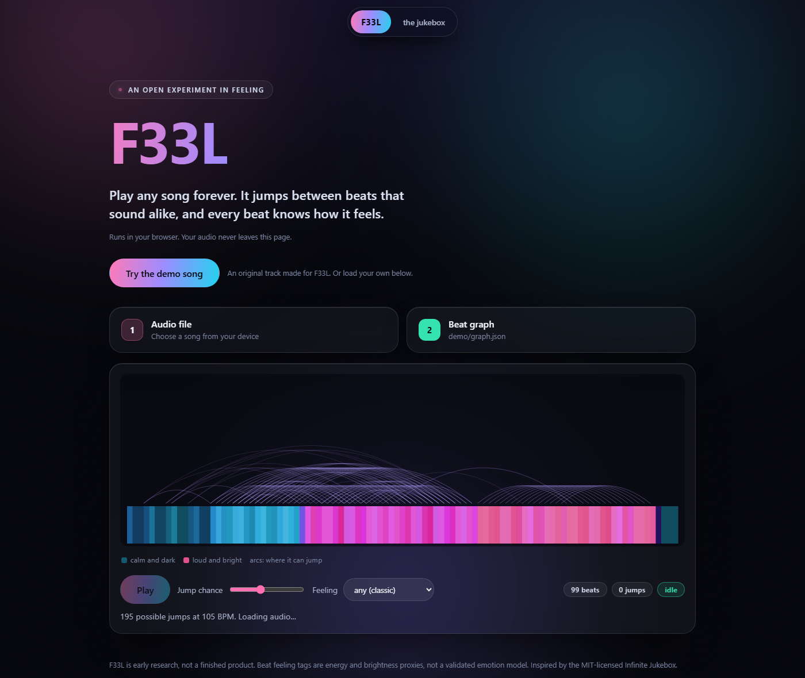
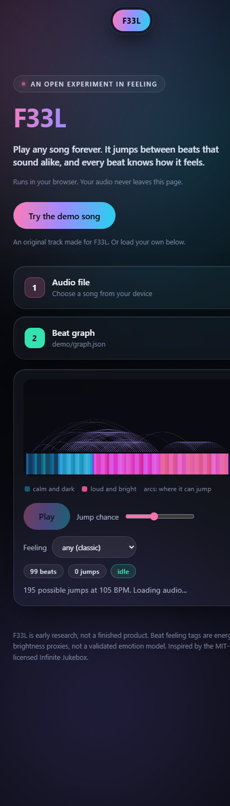

# F33L

**Play any song forever. It jumps between beats that sound alike, and every beat knows how it feels.**

An open experiment: can a computer learn how humans perceive and feel music? F33L measures the sound (tempo, key, pitch,
dynamics, texture), builds a map of which beats resemble each other, and tags every beat with its energy and brightness so
you can steer a song by feeling. Everything runs in your browser. Your audio never leaves your device.

**Live demo:** https://tootenramen.github.io/F33L/ (plays an original track made for F33L; load your own song too)

## What's inside

| Path | What it is |
|---|---|
| `index.html` | the jukebox player: beat map, jump arcs, "stay in the feeling" modes |
| `src/listen.py` | a moment-by-moment listening transcript for any song |
| `src/jukebox.py` | builds the beat-similarity jump graph, locally |
| `src/align.py` | lines up lyric timings with the energy curve |
| `src/make_demo.py` | generates the original demo track and its graph |
| `tests/` | synthetic-audio tests with known answers |
| `docs/` | the roadmap and screenshots |

## Use it
1. Open the live demo and press **Try the demo song**, then **Play**.
2. For your own song, run `python src/jukebox.py song.mp3 --ffmpeg ffmpeg --out graph.json` (needs Python, numpy and ffmpeg), then load the audio and `graph.json` on the page.
3. Try **Feeling**: stay in the energy, build up, or wind down.

## The idea
1. **Measure the sound.** Turn audio into interpretable features: tempo, meter, key and mode, chord motion, melodic contour, register, dynamics, spectral brightness, roughness, texture, silence.
2. **Map to emotion.** Link those features to emotion using published music-psychology models (valence-arousal, discrete emotions, expectation and tension/release) instead of ad hoc guesses.
3. **Explain.** Give an AI a structured, readable "score card" it can reason over, and have it say *why* a song is likely to feel the way it does.
4. **Test against people.** Compare predictions to human ratings. Report where it is right, where it is wrong, and where listeners disagree with each other.

## Research questions
- Which features carry the most emotional signal, and how much of it is universal vs cultural or personal?
- Can a language model, given only a feature report, predict human valence/arousal better than a plain audio classifier?
- Does adding music-theory knowledge (modes, cadences, tension) improve both accuracy and explanations?
- How should a system express uncertainty when listeners genuinely disagree?
- What can a system *not* know about a person's experience (memory, context, culture)?

## Approach (v0 sketch)
- Python feature extraction (candidates: librosa, essentia, madmom) producing a versioned JSON report per track.
- Baselines: simple regression/classifiers on public emotion-annotated datasets.
- LLM layer: reads the report, predicts emotion with confidence and a short rationale.
- Evaluation: held-out human ratings, agreement between raters as the ceiling, and calibration of confidence.

## Candidate public resources (check each license before use)
- Valence-arousal circumplex (Russell) and GEMS music emotion scales.
- Annotated datasets such as DEAM, PMEmo and MTG-Jamendo mood/theme tags.
- Key-finding profiles (Krumhansl-Schmuckler) and standard chord/key detection methods.

## Principles
- **Open.** Apache-2.0. Methods, data processing and results are published, including negative results.
- **Honest.** No claim without a measurement. Report uncertainty and disagreement.
- **Respectful of music and listeners.** Use only audio and data we are licensed to use. Do not redistribute copyrighted recordings. Human listening studies need consent and privacy.
- **People first.** The goal is to help people connect with music and with each other, not to replace listening.

## Status
Early, working prototypes (all local; audio never leaves your machine; needs ffmpeg + numpy):
- `src/listen.py`: a moment-by-moment "listening transcript" (loudness, brightness, rhythmic density, tempo, key guess per section).
- `src/align.py`: lines up lyric timings (faster-whisper) with the energy curve. Outputs stay in the git-ignored `outputs/`; do not publish lyrics of copyrighted songs.
- `src/jukebox.py` + `index.html`: a locally computed beat-similarity jump graph and a browser player that plays a song forever by jumping between beats that sound alike, with per-beat energy/brightness tags and a "stay in the feeling" mode. Inspired by the MIT-licensed Infinite/Eternal Jukebox (no Spotify API needed here).
- `tests/`: synthetic-audio tests (known key, known tempo, known repeating structure). Run: `python -m unittest tests.test_listen`.

Known limits: key detection is unreliable on rap/vocal-heavy music; tempo can be half/double; the per-beat "feeling" tags are simple energy/brightness proxies, not a validated emotion model; the browser player has not yet had a listening test on real tracks.

## Contributing
Musicians, music theorists, psychologists, audio engineers and ML people are all welcome. Open an issue with a question, a paper, a dataset or a critique.

---
Built by [Gustavo Freitas](https://github.com/Tootenramen) - [LinkedIn](https://www.linkedin.com/in/gustavo-freitas-69b93910b/) - [more projects](https://github.com/Tootenramen)
