# How F33L works

> **A science experiment you can hear.** F33L listens to a song, finds every beat, works out which beats *sound alike*,
> and then wanders the song forever, jumping between look-alike beats so the music never has to end.
> Along the way it tags every beat with how it *feels*. This page shows how, with real data from the demo track.
> Every data chart below is generated by [`tools/make_figures.py`](../tools/make_figures.py) from the actual
> [`demo/graph.json`](../demo/graph.json) the engine produced. The result charts use the numbers in the
> [devlog](DEVLOG.md), including the experiments that failed.

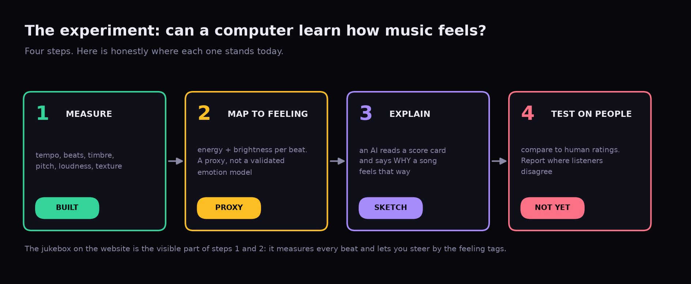

**The question:** can a computer learn how humans perceive and feel music? Step 1 (measure the sound) is built and running in
your browser. Step 2 (a feeling per beat) works as an honest *proxy*, not a validated emotion model. Steps 3 and 4 (explain it, then
test it against real listeners) are the research still ahead. The "Teach it" buttons in the player are the first data collector for step 4.

---

## 1. The whole machine, in one picture

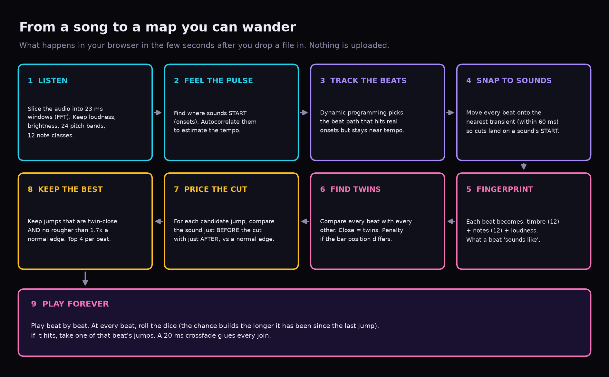

Nine stages, all running in your browser tab (nothing is uploaded). The next sections walk through them using one real song.

---

## 2. Meet the demo song

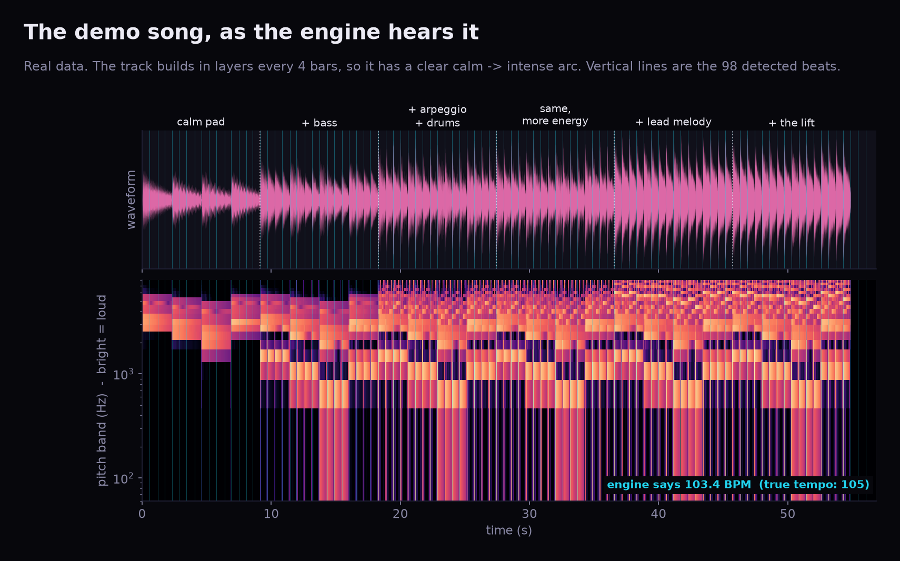

The demo track is an original made for F33L (see [`src/make_demo.py`](../src/make_demo.py)). It is built in **layers**, one new layer every four bars:
a calm pad, then bass, then arpeggio and drums, then a lead melody and a final lift. That gives it a clear arc from calm to intense,
which is exactly what you need to test a "feeling" detector.

Top: the waveform. Bottom: a spectrogram (pitch bands against time; bright = loud). The cyan lines are the **98 beats** the engine found.

Look at the bottom right: the engine says **103.4 BPM**, but the track was written at **105 BPM**. The tempo estimate is slightly off.
That is normal for an autocorrelation estimate, and it matters in the next step.

---

## 3. Finding the beat (and why a metronome isn't enough)

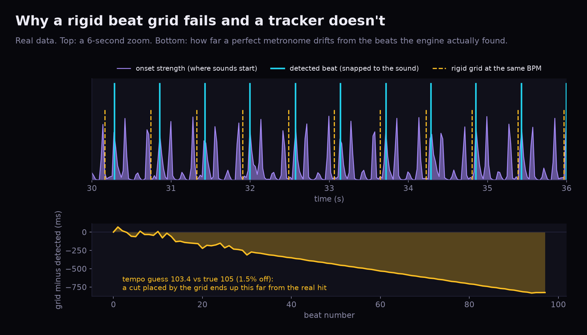

First the engine measures **onset strength**: how suddenly new sound appears in each 23 ms slice (purple). Peaks are drum hits and note attacks.

A naive approach would draw a rigid grid at the estimated tempo (yellow dashes). But look at the bottom panel: because the guess is 1.5% off,
a perfect metronome slides **almost a full second** away from the real beats by the end of one minute. Cut there and you land in the middle of a sound.

So F33L uses a **dynamic-programming beat tracker** (in the style of Ellis 2007). It scores every possible path of beats and picks the one that
lands on strong onsets while staying close to the tempo. Then every beat is **snapped to the nearest transient** within 60 ms (cyan), so a cut
starts on the front edge of a sound instead of inside it.

---

## 4. Which beats are twins?

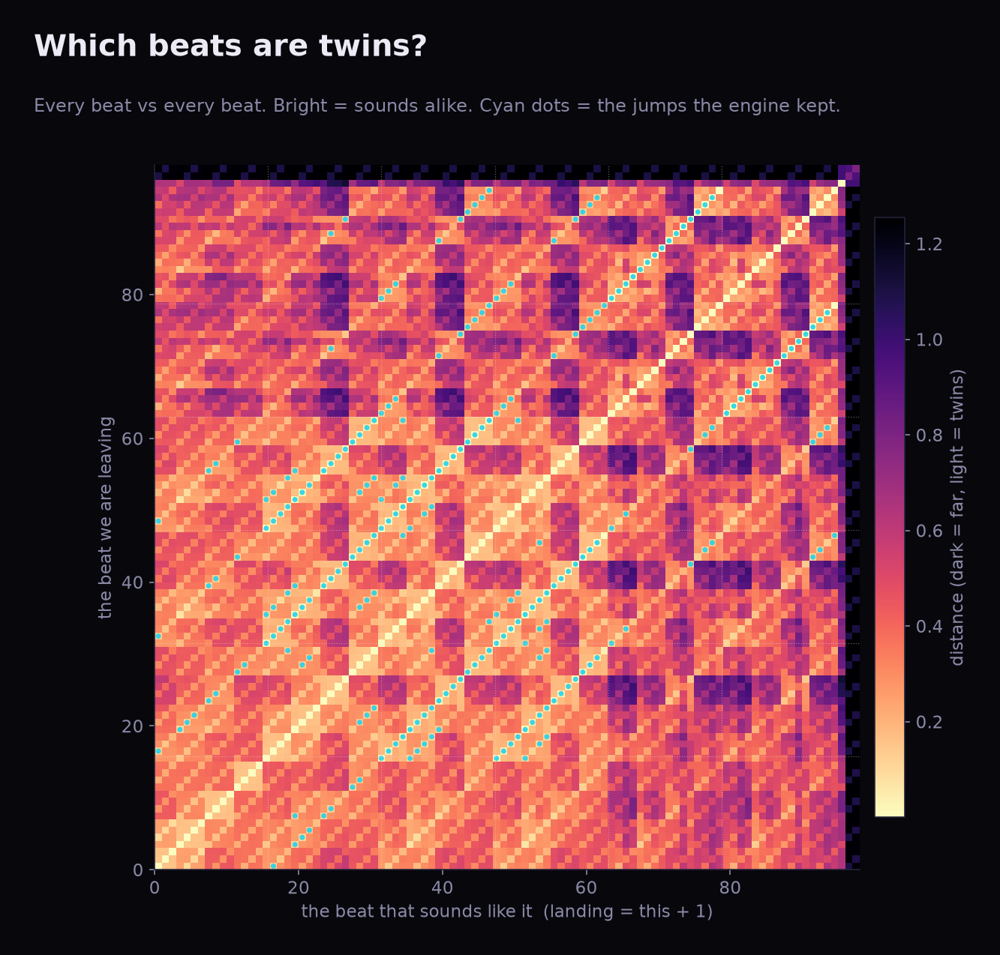

Every beat gets a **fingerprint**: its timbre (12 numbers: the shape of the sound across pitch bands), its notes (12 numbers: how much of each of the
12 pitch classes), and its loudness. Two beats are "twins" when their fingerprints are close
(distance = 0.5 × timbre + 0.3 × notes + 0.2 × loudness, plus a 0.15 penalty if they sit in different places in the bar).

The picture compares **every beat with every other beat**. Light cells are twins, dark cells are strangers. You can see the song's structure
appear on its own: the repeated chord loop is the checkerboard, and the late sections (dark band at the right) are unlike the calm start.
The **cyan dots are the jumps the engine actually kept**. They sit on the light diagonals, exactly where beats repeat.

*(This chart recomputes the fingerprint in Python from the engine's formulas so you can see the matrix. The engine itself runs the same idea in JavaScript.)*

---

## 5. The jump graph

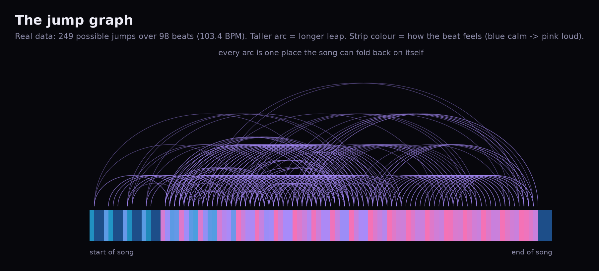

The kept jumps, drawn as arcs over the song's timeline. The strip underneath is coloured by how each beat feels (blue = calm, pink = loud).
**249 jumps across 98 beats.** Every arc is a place where the song can fold back on itself. Playing "forever" is just a random walk on this graph.

Short arcs connect repeats of the chord loop; the tall ones leap across whole sections. Where the arcs bunch up, the song repeats itself most.

---

## 6. The most important rule: land one beat *after* the match

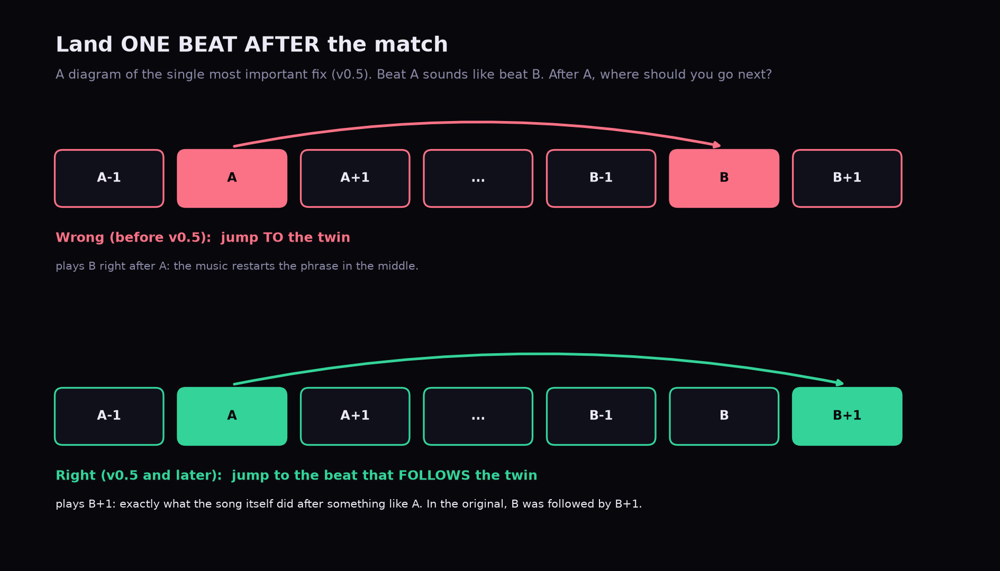

The first version jumped *to* the matching beat and the result sounded broken. A listener compared it with the Eternal Jukebox, which sounded clean.
The fix (v0.5): if beat **A** sounds like beat **B**, don't jump to B. Jump to **B+1**, the beat that *followed* B in the original song.
Then the music keeps the flow it had.

---

## 7. Pricing every cut

A jump is only good if the cut itself is smooth. For every candidate jump the engine compares the sound just **before** the cut with the sound just **after**,
and divides by how rough a normal beat boundary is in the same song.

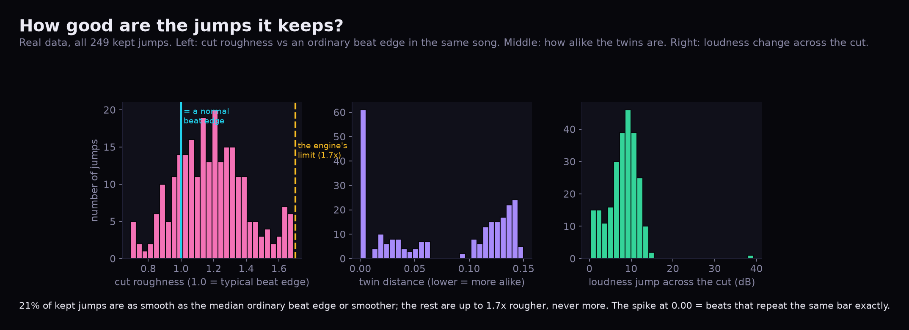

Real data for all 249 kept jumps. **1.0** on the left chart means "as rough as a typical beat edge in this song". The engine refuses anything above **1.7×**.
About a fifth of the jumps are as smooth as an ordinary beat edge or smoother, and none is rougher than 1.7×.
The spike at 0.00 in the middle chart is beats that repeat the same bar *exactly* (the demo is synthetic, so some repeats are near-identical).

---

## 8. Gluing the audio together

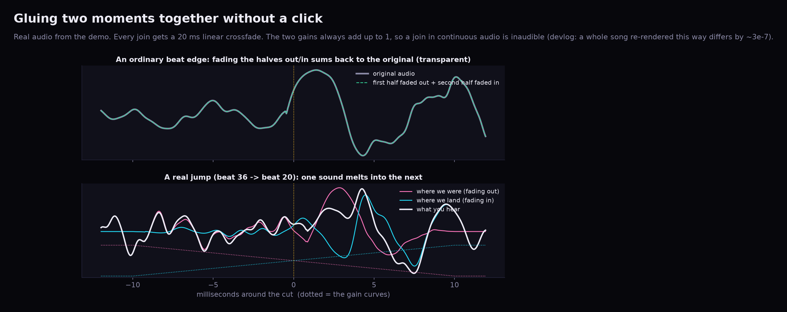

Every join gets a **20 ms crossfade**: the old sound fades out while the new one fades in. The two gains always add up to 1, so when the audio is continuous
the crossfade changes nothing (a whole song re-rendered with it differs from the original by about 0.0000003). On a real jump (bottom), one sound melts into the next.

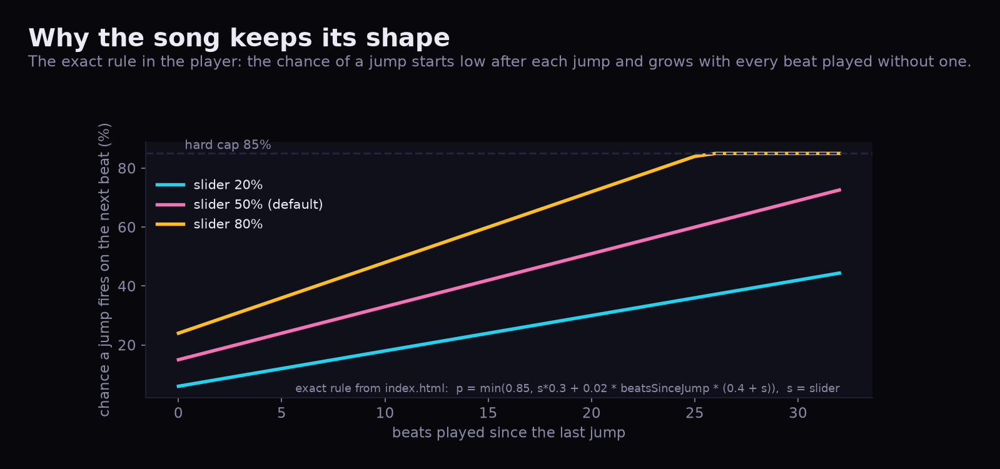

And F33L doesn't jump constantly. The chance of a jump **starts low after each jump and grows with every beat played without one**, up to an 85% cap,
so the song keeps its shape. The slider sets how eager it is. (This is the exact formula from the player.)

---

## 9. How a beat "feels"

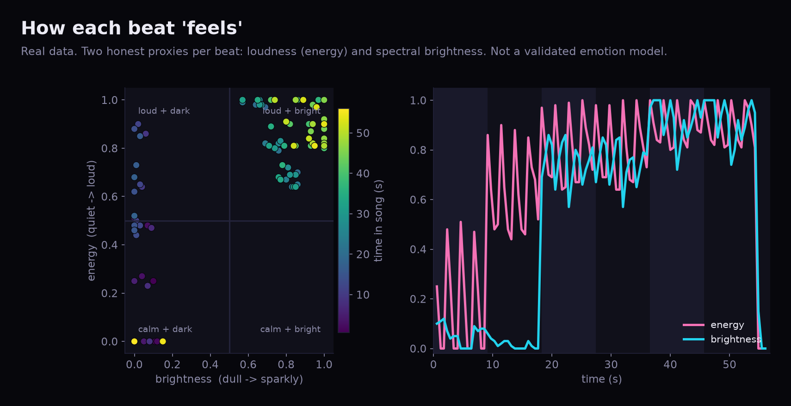

Each beat gets two numbers between 0 and 1:

- **Energy**: how loud the beat is, compared with the quietest and loudest tenth of the song.
- **Brightness**: how high the sound's centre of mass sits in pitch (the *spectral centroid*).

Those two axes are the "calm to loud" and "dark to bright" the player colours. On the left, every beat is a dot; on the right, the song over time.
You can see the story the song was built to tell: for the first 18 seconds brightness is almost zero (a pad and a bass have nothing sparkly in them),
then it **jumps the moment the hi-hats arrive**, and energy stays high through the lift.

The **Feeling** menu uses these numbers. *Stay in the energy* only takes jumps to beats within ±0.15 of the current energy. *Build up* only jumps to equal or louder beats. *Wind down* the opposite.

**Be honest about what this is.** Loudness and brightness are well-established correlates of *arousal* (how intense music feels). They say far less about
*valence* (how positive it feels), and nothing about memory, culture or taste. This is a proxy, not an emotion detector. Making it more than that is the real research.

---

## 10. Did the engine actually get better?

Some honest measurements, from [`docs/DEVLOG.md`](DEVLOG.md). All on one machine, one or two songs: hints, not benchmarks.

### v1 → v2: the big fix

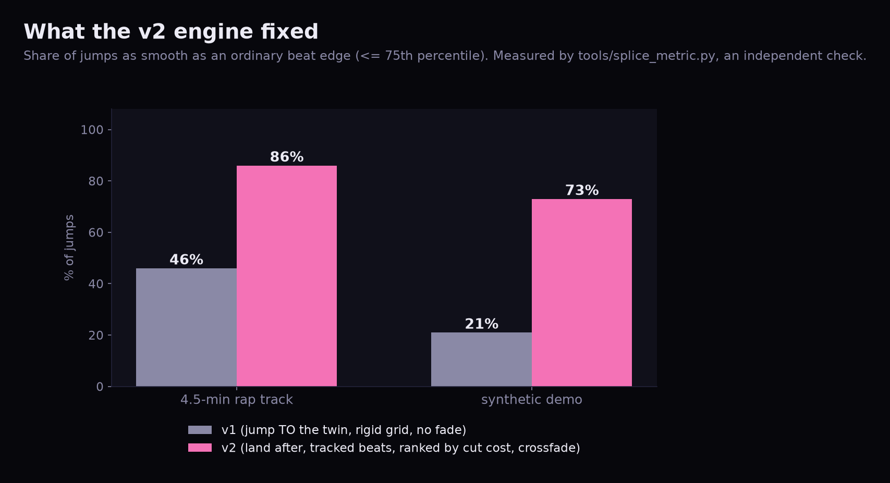

Land-after, a tracked beat grid, ranking by real cut cost and a crossfade lifted the share of "ordinary-smooth" jumps from **46% to 86%** on a 4.5-minute rap track
and from **21% to 73%** on the demo, as judged by [`tools/splice_metric.py`](../tools/splice_metric.py), a separate checker that measures the audio around each cut.

### Can a model learn what a natural cut sounds like?

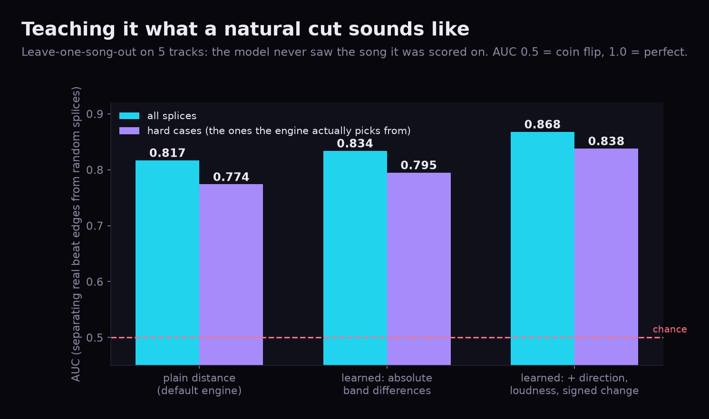

Real beat boundaries are examples of continuity; random splices are examples of breaks. A small model trained on the difference separates them better than the plain
distance, tested **leave-one-song-out on five tracks** so it never saw the song it was scored on (AUC 0.817 → 0.868).
It is shipped as an *option* (the "Cut style" menu), not the default, because of the next chart.

### What did not work

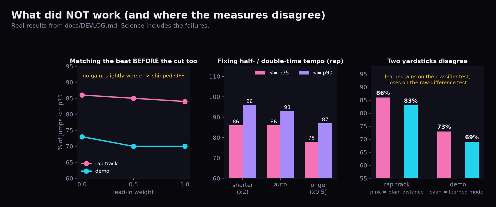

- **Left:** also matching the beat *before* the cut (a "phrase lead-in") gave no gain. Shipped **off**.
- **Middle:** tempo readings that land on half- or double-time are fixed by a *Beat length* switch. On the rap track, shorter beats lose nothing and give finer cut points.
- **Right:** two ways of judging smoothness **disagree**. The learned model wins the classifier test and slightly loses the raw-difference test. Neither is ears.
  That is why the player lets *you* A/B them.

### The hard problem: words

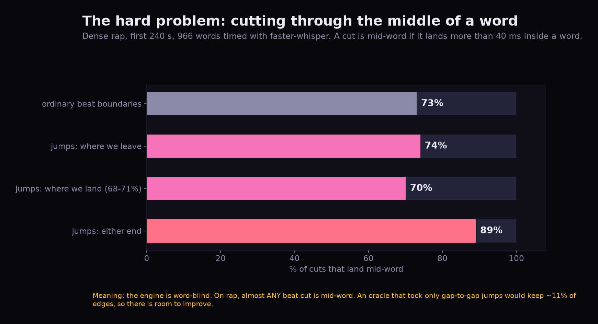

On dense rap, **73% of ordinary beat boundaries already land in the middle of a word**, and jumps are no better (89% have a mid-word cut at one end or the other).
The engine can't hear words. This is the biggest known limitation, and the next thing to fix: a cut that only hops between gaps would keep roughly 11% of edges, so there is room.

---

## 11. What F33L can't do (yet)

- **It does not understand emotion.** It measures sound features that correlate with intensity. Valence, meaning and personal memory are out of reach so far.
- **Ground truth has to be human.** No proxy hears a cut in the middle of a word. The **G / B** buttons in the player (smooth / off) collect labels so a model can be fit to real listeners.
- **Key detection is unreliable on vocal-heavy music, and tempo can be half/double.** Both known.
- **Tested on a handful of songs.** The numbers above are hints, not a benchmark.

---

## 12. Who else is working on this?

F33L sits inside a real research field called **music emotion recognition (MER)**. It isn't alone, and you can use all of this work.

**Datasets people train on**
- **DEAM**: valence and arousal labels over time for about 1,800 songs and excerpts (from the MediaEval *Emotion in Music* tasks, 2013 to 2015).
- **PMEmo**, **AMG1608** (1,608 Western songs rated for arousal and valence) and [**MERGE**](https://arxiv.org/html/2407.06060v1) (audio plus lyrics) are other widely used sets.
- **MIREX audio mood classification**: the long-running annual benchmark that sorts songs into five mood clusters.

**Surveys and curated lists**
- ["Are We There Yet? A Brief Survey of Music Emotion Prediction Datasets, Models and Outstanding Challenges"](https://arxiv.org/html/2406.08809v2): the best overview of where the field stands and what is still unsolved.
- [**awesome-MER**](https://github.com/AMAAI-Lab/awesome-MER) (AMAAI Lab): a maintained list of datasets, models and papers.

**Newer: audio language models**
- [**CMI-Bench**](https://arxiv.org/abs/2506.12285) (ISMIR 2025): tests audio-text LLMs on music tasks including predicting arousal/valence and emotion tags.
- [**AImoclips**](https://arxiv.org/html/2509.00813v2): the reverse direction. Do AI music generators actually convey the emotion they were asked for? Finding: they lean toward neutral.
- [**LISTEN**](https://arxiv.org/html/2510.10444v2): in *speech*, audio LLMs seem to "transcribe" emotion from words more than they "listen" to the sound. Worth keeping in mind for music with lyrics.

**What the field keeps finding:** audio features predict **arousal** well and **valence** poorly, and lyrics often beat audio for valence. That matches
what you see in F33L's own proxy.

**Where F33L is different:** most MER work *predicts a label for a song*. F33L lets you **steer playback by feeling** and keeps a public log of the
experiments that failed. I haven't found another project that combines infinite beat-jumping with per-beat feeling tags, but I can't prove nobody has.
If you know one, [open an issue](https://github.com/Tootenramen/F33L/issues).

---

## Reproduce every chart

```
pip install numpy matplotlib
python tools/make_figures.py --ffmpeg ffmpeg
```

Data charts read [`demo/demo.mp3`](../demo/demo.mp3) and [`demo/graph.json`](../demo/graph.json). Result charts use the numbers recorded in the devlog.
Diagrams are labelled as diagrams.

[← Back to the README](../README.md) · [Try the live demo](https://tootenramen.github.io/F33L/)
